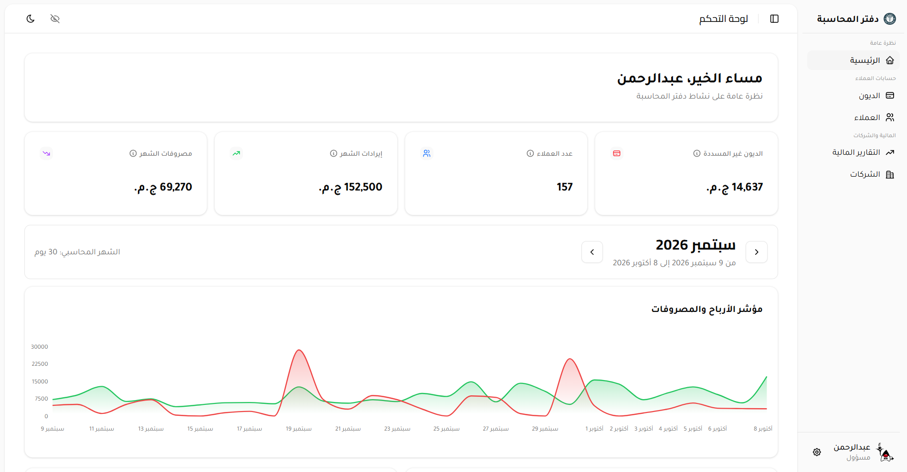
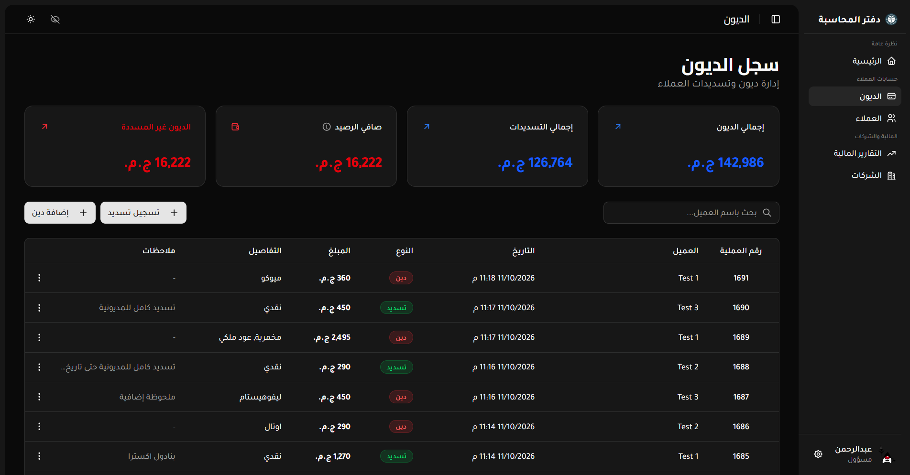
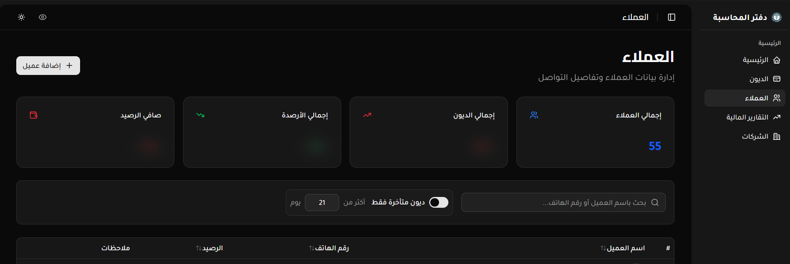
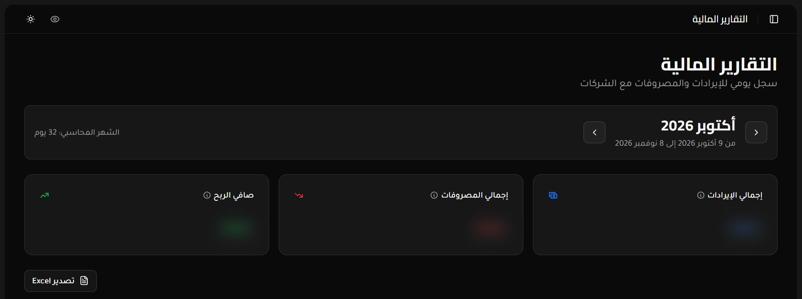

# Pharma Ledger

Desktop financial management system for pharmacies to track daily income, operational expenses, customer debts, and automated backups.

[](package.json)
[](https://react.dev/)
[](https://www.electronjs.org/)
[](https://sqlite.org/)

<p align="center">
  
</p>

---

## Screenshots

<div align="center">

### 1. Main Dashboard (لوحة التحكم الرئيسية)
> Financial summary cards, monthly income vs. expenses, customer debt statistics, and interactive charts.

<p align="center">
  
</p>

### 2. Debts & Ledger Management (سجل الديون والمدفوعات)
> Detailed customer debts and repayment transactions with payment methods and status tags.

<p align="center">
  
</p>

### 3. Search & Quick Filters (البحث والتصفية السريعة)
> Fast search across customers, transactions, dates, and amounts with instant filtering.

<p align="center">
  
</p>

### 4. Privacy Mode (وضع الخصوصية وإخفاء الأرقام)
> One-click sensitive data masking to protect financial balances while interacting with customers.

<p align="center">
  
</p>

</div>

---

## Features

- **Financial Analytics & Dashboard:** Daily income & expenses tracking, interactive monthly charts (Recharts), and smart alerts.
- **Customer Debts & Ledgers:** Customer debt records, transaction histories, and repayment logging.
- **Role-Based Authentication:** Multi-user access control (Admin & Employee) with encrypted credentials.
- **Automated Backups:** Scheduled daily SQLite database backups delivered via email.
- **RTL & Modern UI:** Arabic-first RTL support, dark/light themes, built with Tailwind CSS & Radix UI.
- **Local-First Architecture:** Fast, offline-first SQLite database (`better-sqlite3` with WAL mode).

---

## Tech Stack

- **Frontend:** React 19, TypeScript, Vite, Tailwind CSS, Radix UI, Lucide & Tabler Icons
- **State Management:** TanStack Query (React Query)
- **Desktop Core:** Electron 38, Node.js
- **Database:** SQLite via `better-sqlite3`
- **Services:** `nodemailer` & `node-cron` for automated email backups

---

## Getting Started

### Prerequisites

- Node.js (v20+ recommended)
- C++ build tools (required for native `better-sqlite3` compilation)

### 1. Installation

```bash
git clone https://github.com/t0khyo/pharma-ledger.git
cd pharma-ledger
npm install
npm run rebuild
```

### 2. Environment Setup (Optional)

Create a `.env` file in the root directory to enable automated database backups:

```env
EMAIL_USER=your-email@gmail.com
EMAIL_PASSWORD=your-app-password
BACKUP_RECIPIENT=recipient@example.com
BACKUP_ENABLED=true
```

### 3. Development

```bash
npm run dev
```

---

## Available Scripts

| Command | Description |
| --- | --- |
| `npm run dev` | Run Vite and Electron concurrently in development mode |
| `npm run build` | Type-check and build React frontend for production |
| `npm run rebuild` | Rebuild `better-sqlite3` for the installed Electron version |
| `npm run lint` | Run ESLint checks across the codebase |
| `npm run dist:win` | Build and package Windows installer (`.exe`) |
| `npm run dist:mac` | Build and package macOS installer |
| `npm run dist:linux` | Build and package Linux installer |

---

## Database Location

The SQLite database (`app.db`) is stored in the local application data directory:

- **Windows:** `%APPDATA%/Pharma Ledger/app.db`
- **macOS:** `~/Library/Application Support/Pharma Ledger/app.db`
- **Linux:** `~/.config/Pharma Ledger/app.db`

---

## License

Private project. All rights reserved.

